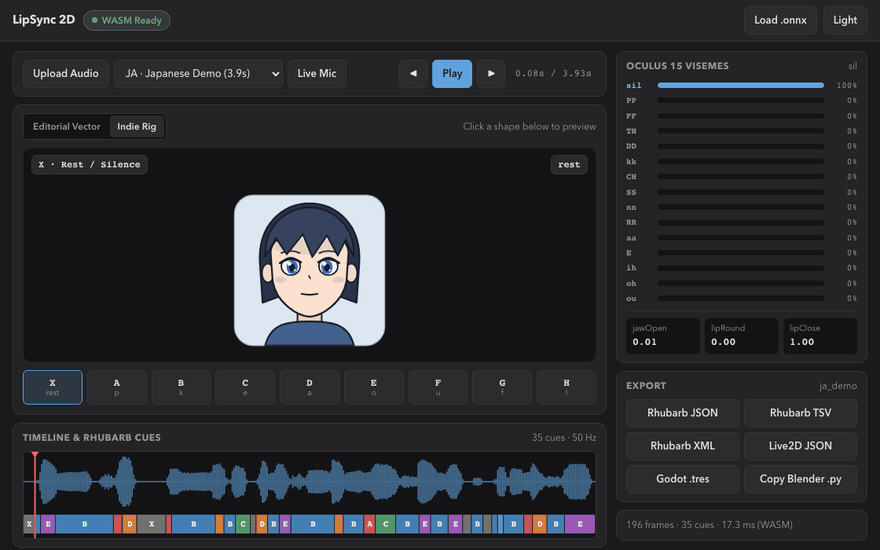

# lipsync-2d

[Live Browser Studio](https://lumonopolis.github.io/lipsync-2d/) · [Hugging Face Weights](https://huggingface.co/Lumonopolis/lipsync-2d) · [Benchmarks](BENCHMARKS.md) · [Model Card](MODEL_CARD.md) · Apache-2.0

Rhubarb Lip Sync is still the default for 2D animation, but it's English-only, offline-only, and struggles on high-pitched voices. **`lipsync-2d`** is a **6.5 MB** Apache-2.0 ONNX model that handles **7 languages**, streams live in the browser at **~1.5 ms/frame**, and drops straight into Rhubarb, Godot 4, Blender, and Live2D workflows.

<p align="center">
  
</p>
<p align="center">
  <sub>Real Japanese speech analyzed live in-browser via WASM ONNX (6.5 MB FP16) — 9 Rhubarb mouth shapes, 15 Oculus visemes, and continuous mouth curves.</sub>
</p>

## Why use it

- **Multilingual out of the box:** Trained on English, Spanish, French, German, Mandarin, Korean, and Japanese — no phoneme dictionary or language switch required.
- **Built for real voices and quiet mics:** Handles female/high-pitched voices without collapsing and includes clip-level speech-gated RMS normalization so quiet recordings don't vanish into silence (`0.00%` room-noise jaw-flap).
- **Runs anywhere, fast:** `6.55 MB` FP16 (`3.57 MB` INT8) ONNX with zero recurrent/GRU bottlenecks — runs at **11–16× real-time** in browser WASM (`40 ms` streaming lookahead) and `<0.2 ms/frame` offline on CPU.
- **Drop-in pipeline exports:** Emits standard **Rhubarb JSON / TSV / XML**, **Live2D JSON**, **Godot 4 `Animation` `.tres`**, and **Blender 5.x `.py`** scripts (verified headless in Blender 5.2 LTS and Godot 4.7).
- **Clean commercial license:** Apache-2.0 code and weights trained exclusively on commercially permissive **CC0-1.0** and **CC-BY-4.0** speech corpora (LibriSpeech, Google FLEURS, Common Voice 19, Zeroth-Korean).

## Try It in 10 Seconds

### 1. Browser Studio (Zero Install)
Open **[lumonopolis.github.io/lipsync-2d](https://lumonopolis.github.io/lipsync-2d/)** to test built-in English, Japanese, and Spanish clips, drag in your own `.wav`/`.mp3`, or stream live from your microphone.

### 2. Rhubarb-Compatible CLI
The CLI auto-downloads and caches the FP16 ONNX weights from Hugging Face on first run (or pass `--model local.onnx` to run completely offline):

```bash
pip install -e ".[onnx]"

# Drop-in Rhubarb JSON / TSV / XML
lipsync-2d voice.wav -f json -o cues.json
lipsync-2d voice.wav -f tsv  -o cues.tsv
lipsync-2d voice.wav -f xml  -o cues.xml

# Direct DCC / Rig exports
lipsync-2d voice.wav -f live2d  -o live2d.json
lipsync-2d voice.wav -f godot   -o mouth.tres
lipsync-2d voice.wav -f blender -o animate_mouth.py
```

### 3. TypeScript / Browser API

```ts
import { LipSyncEngine, toRhubarbJson, toGodotTres } from "lipsync-2d-web";

const engine = new LipSyncEngine({ wasmPaths: "/ort/" });
await engine.loadModel("/models/lipsync2d.onnx", "/models/lipsync2d_stream.onnx");

const result = await engine.analyzeAudio(audioBuffer);
const rhubarbJson = toRhubarbJson(result.rhubarbCues, result.duration, "voice.wav");
const godotTres = toGodotTres(result.rhubarbCues, result.duration);
```

To run the Studio locally:

```bash
cd packages/lipsync-2d-web && npm install && npm run build
cd ../../web && npm install && npm run dev
```

## Head-to-Head vs Official Rhubarb v1.14.0

Evaluated zero-shot on **90 distinct balanced speakers (`45` Male / `45` Female)** from human hand-annotated TIMIT test phonemes (zero training or teacher overlap). Full tables, 3,600-utterance 7-language scores, ONNX latency, and Py↔TS parity live in **[BENCHMARKS.md](BENCHMARKS.md)**.

| Human-Annotated TIMIT (90 distinct speakers) | `lipsync-2d` (Viterbi) | `Rhubarb v1.14.0` | Delta |
| --- | ---: | ---: | ---: |
| **9-Rhubarb Macro-F1** ↑ | **0.616** | 0.432 | **+18.4 pts (1.42×)** |
| **Bilabial `A` (`p, b, m`) F1** ↑ | **0.555** | 0.323 | **+23.2 pts (1.72×)** |
| **Boundary Onset MAE** ↓ | **25.2 ms** | 44.6 ms | **-43.4%** |
| **Silence Jaw-Flap FP** ↓ | **5.7%** | 32.5% | **-82.5%** |
| **High-Pitch `+4st` Female Macro-F1** ↑ | **0.466** | 0.277 | **+18.9 pts (1.68×)** |

## Limitations

- **Per-language spread:** Spanish (`0.791`), English (`0.756`), and French (`0.702`) are strongest; Japanese (`0.611`) is lower due to smaller open speaker diversity and phonotactics lacking native `/f, v/` (`G`) contrasts.
- **Clean/read speech focus:** Heavy background music, overlapping multi-speaker dialogue, or extreme screaming/singing can degrade viseme boundaries.
- **Streaming lookahead:** The stateful streaming ONNX graph runs strictly causally with a `40 ms` (2-frame) lookahead delay to keep plosive (`p/b/m`) closures crisp.

## License

Apache-2.0 — see [LICENSE](LICENSE) and [MODEL_CARD.md](MODEL_CARD.md).
